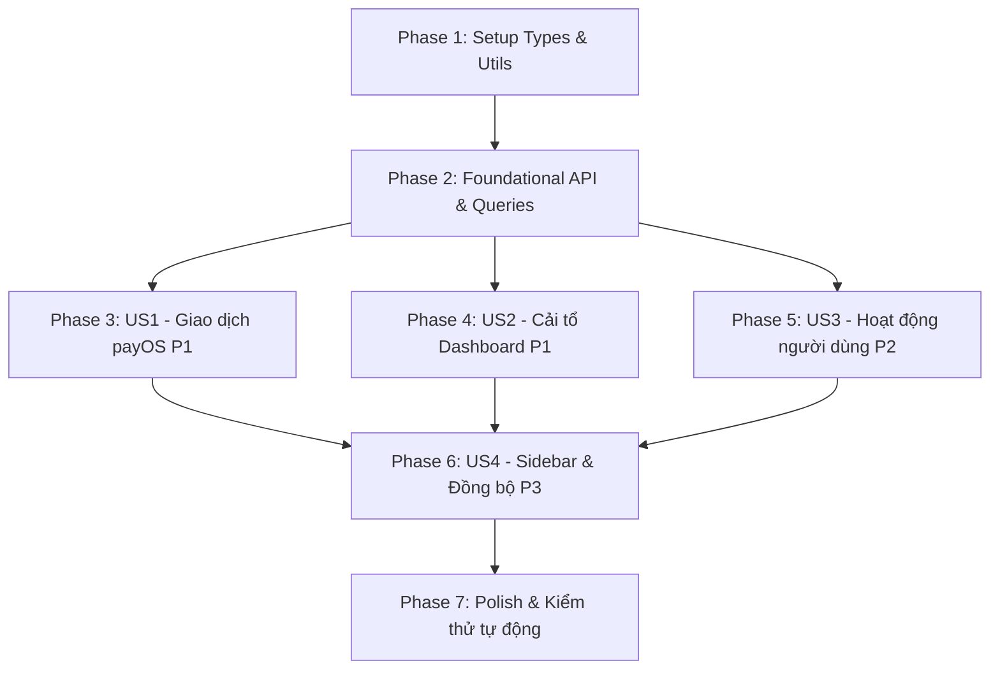

# Tasks: Admin Observability & Operational Dashboard

**Feature**: `034-admin-observability`
**Date**: 2026-10-16
**Spec**: [spec.md](./spec.md) | **Plan**: [plan.md](./plan.md)

---

## Phase 1: Setup & Shared Types/Utils

**Purpose**: Định nghĩa kiểu dữ liệu DTO và tiện ích dùng chung cho các màn hình quản trị mới và dashboard.

- [X] T001 [P] Cập nhật kiểu dữ liệu PayOS và AIEvent trong `src/features/admin/types/dashboard.ts` (thêm `pendingCount`, `voidedCount` vào `PayOSReconciliation`, thêm `errorCode` vào `AIEvent`)
- [X] T002 [P] Tạo kiểu dữ liệu giao dịch PayOS và các action đối soát trong `src/features/admin/types/transactions.ts` (`TransactionStatus` 11 giá trị, `DepositTransaction`, `ResolvePaidRequest`, `ResolveActionRequest`, `TransactionQuery`, `TransactionList`)
- [X] T003 [P] Tạo kiểu dữ liệu nhật ký hoạt động người dùng trong `src/features/admin/types/activity.ts` (`ActivityEventType`, `ActivityEvent`, `ActivityEventQuery`, `ActivityEventList`)
- [X] T004 [P] Cập nhật tiện ích ngày giờ Việt Nam và presets trong `src/features/admin/utils/dashboard.ts` (`todayVN`, `startOfMonthVN`, `daysAgoVN` theo `Asia/Ho_Chi_Minh`, presets "Hôm nay", "Tháng này", "30 ngày gần nhất", loại bỏ fallback im lặng)
- [X] T005 [P] Tạo tiện ích map 11 trạng thái giao dịch và format tiền tệ trong `src/features/admin/utils/transactions.ts` (mapping nhãn tiếng Việt, màu badge, định dạng VND)
- [X] T006 [P] Tạo tiện ích format hiển thị hoạt động người dùng trong `src/features/admin/utils/activity.ts` (ghép họ tên với fallback email, map badge đăng nhập/làm mới)

---

## Phase 2: Foundational API & React Query Layer

**Purpose**: Xây dựng tầng gọi API và React Query hooks cho toàn bộ các endpoint quan sát.

- [X] T007 [P] Cập nhật tham số ngày cho các endpoint dashboard trong `src/features/admin/api/dashboard.api.ts` (nhận `{ fromDate, toDate }` cho `distribution`, `revenue-breakdown`, `renewal-stats`, `error-breakdown`, và bổ sung hàm `getPayOSReconciliation`)
- [X] T008 [P] Tạo API client cho giao dịch và đối soát PayOS trong `src/features/admin/api/transactions.api.ts` (`getTransactions`, `getTransaction`, `resolvePaid`, `resolveCancelled`, `resolveCreationFailed`, `retryInvestigation`)
- [X] T009 [P] Tạo API client cho nhật ký hoạt động người dùng trong `src/features/admin/api/activity.api.ts` (`getActivityEvents`)
- [X] T010 [P] Cập nhật React Query hooks cho dashboard trong `src/features/admin/queries/dashboard.queries.ts` (cập nhật query keys có `{ fromDate, toDate }`, thêm hook `useDashboardPayOSReconciliation`)
- [X] T011 [P] Tạo React Query hooks và mutations cho giao dịch trong `src/features/admin/queries/transactions.queries.ts` (`useTransactions`, `useTransaction`, và 4 mutation hooks đối soát với cơ chế invalidate/refetch)
- [X] T012 [P] Tạo React Query hooks cho nhật ký hoạt động trong `src/features/admin/queries/activity.queries.ts` (`useActivityEvents`)

---

## Phase 3: User Story 1 - Giám sát & Đối soát Giao dịch payOS (Priority: P1) 🎯 MVP Part 1

**Goal**: Cung cấp giao diện quản trị tra cứu toàn bộ giao dịch payOS (11 trạng thái) và thực hiện 4 thao tác đối soát thủ công có kiểm soát an toàn.

**Independent Test**: Quản trị viên truy cập `/admin/transactions`, lọc giao dịch `reconciliation_required`, xem chi tiết và nhấn "Xác nhận đã thanh toán" với mã tham chiếu, hệ thống cập nhật trạng thái mới nhất ngay lập tức.

- [X] T013 [P] [US1] Xây dựng thanh công cụ lọc giao dịch trong `src/app/admin/transactions/components/TransactionsToolbar.tsx` (dropdown 11 trạng thái + Tất cả, chọn khoảng ngày với preset VN, chọn số bản ghi/trang)
- [X] T014 [P] [US1] Xây dựng hộp thoại xác nhận đối soát thủ công trong `src/app/admin/transactions/components/ReconciliationActionDialog.tsx` (hỗ trợ nhập `reason`, riêng `resolve-paid` bắt buộc nhập `reference` và `paymentLinkId`)
- [X] T015 [US1] Xây dựng modal chi tiết giao dịch trong `src/app/admin/transactions/components/TransactionDetailModal.tsx` (hiển thị toàn bộ trường camelCase, link `paymentUrl`, badge trạng thái và điều kiện bật 4 nút hành động)
- [X] T016 [US1] Xây dựng bảng danh sách giao dịch trong `src/app/admin/transactions/components/TransactionsTable.tsx` (cột mã đơn, loại giao dịch Mua gói/Nạp ví, số tiền VND, badge trạng thái, ngày tạo VN, nút xem chi tiết và phân trang)
- [X] T017 [US1] Xây dựng component client điều phối giao dịch trong `src/app/admin/transactions/components/TransactionsClient.tsx` (đồng bộ bộ lọc vào URL query, thực hiện refetch sau khi mutation đối soát thành công, xử lý lỗi 400/404)
- [X] T018 [US1] Tạo trang router Next.js cho giao dịch payOS tại `src/app/admin/transactions/page.tsx`

---

## Phase 4: User Story 2 - Cải tổ Dashboard Vận hành & Số liệu theo kỳ (Priority: P1) 🎯 MVP Part 2

**Goal**: Sửa 13 vấn đề UX trên Dashboard, tách khối KPI snapshot (~15 phút) khỏi khối phân tích theo kỳ, hỗ trợ preset ngày giờ VN và chuẩn hóa số liệu tỷ lệ lỗi $\le 100\%$.

**Independent Test**: Quản trị viên chọn preset "Tháng này" trên Dashboard, toàn bộ 7 panel theo kỳ đồng loạt cập nhật dữ liệu từ ngày 01 đến hôm nay (giờ VN), panel PayOS hiển thị đủ các nhóm trạng thái và khối KPI hiển thị nhãn snapshot kèm `updatedAt`.

- [X] T019 [US2] Cập nhật thanh công cụ Dashboard trong `src/app/admin/dashboard/components/DashboardToolbar.tsx` (thêm các nút preset "Hôm nay", "Tháng này", "30 ngày gần nhất", "Tùy chọn", hiển thị lỗi 400 bằng tiếng Việt khi khoảng ngày không hợp lệ)
- [X] T020 [US2] Cập nhật hiển thị lưới KPI trong `src/app/admin/dashboard/components/DashboardKpiGrid.tsx` (gắn nhãn snapshot định kỳ kèm mốc `updatedAt`, phân biệt nhãn "Doanh thu hôm nay (ảnh chụp)", bổ sung tooltip giải thích)
- [X] T021 [US2] Cập nhật panel đối soát PayOS trong `src/app/admin/dashboard/components/PayOSPanel.tsx` (bổ sung hiển thị `pendingCount`, `voidedCount`, nhãn "Kỳ đã chọn", hiển thị trực tiếp `totalSuccessValue` từ backend)
- [X] T022 [US2] Cập nhật panel AI Margin trong `src/app/admin/dashboard/components/AIMarginPanel.tsx` (đồng bộ nhãn tiếng Việt "Tokens trả phí", "Lượt gọi AI", "Lỗi AI", parse hiển thị ngày VN tránh lệch múi giờ)
- [X] T023 [US2] Cập nhật khối báo cáo chuyên sâu trong `src/app/admin/dashboard/components/DashboardInsights.tsx` (xóa `console.log` thừa, truyền `{ fromDate, toDate }` cho các query, ghi rõ chú thích phạm vi gói hiện tại và attempt gia hạn)
- [X] T024 [US2] Cập nhật biểu đồ xu hướng trong `src/app/admin/dashboard/components/DashboardTrendChart.tsx` (khắc phục lệch ngày do UTC, sửa label "Tính theo : day" thành "Theo: Ngày", đổi tab "AI Health" thành "Sức khỏe AI")
- [X] T025 [US2] Cập nhật bảng sự kiện AI trong `src/app/admin/dashboard/components/AIEventsTable.tsx` (sửa lỗi dropdown "Tất cả" thành bỏ param `status`, sửa header cột "Loại" thành "Mô hình" và bổ sung cột "Mã lỗi")
- [X] T026 [US2] Cập nhật kết nối dữ liệu trong `src/app/admin/dashboard/components/DashboardClient.tsx` và `src/app/admin/dashboard/components/DashboardData.tsx` (sử dụng `useDashboardPayOSReconciliation` với kỳ ngày chọn, truyền `{ fromDate, toDate }` cho 7 query theo kỳ)

---

## Phase 5: User Story 3 - Truy vết Nhật ký Hoạt động Người dùng (Priority: P2)

**Goal**: Cung cấp giao diện tra cứu lịch sử xác thực (`login`/`refresh`) có lọc theo danh tính người dùng và khoảng thời gian.

**Independent Test**: Quản trị viên lọc theo loại hoạt động "Đăng nhập" trong ngày "Hôm nay" tại `/admin/activity-events`, danh sách hiển thị đúng các bản ghi đăng nhập với tên người dùng/email và giờ Việt Nam.

- [X] T027 [P] [US3] Xây dựng thanh công cụ lọc hoạt động trong `src/app/admin/activity-events/components/ActivityEventsToolbar.tsx` (ô nhập tìm kiếm UUID có validate định dạng, dropdown "Tất cả" / `login` / `refresh`, chọn khoảng ngày với preset VN)
- [X] T028 [P] [US3] Xây dựng bảng hiển thị nhật ký trong `src/app/admin/activity-events/components/ActivityEventsTable.tsx` (thời điểm `occurredAt` giờ VN, tên người dùng fallback email, badge loại hoạt động, copy ID sự kiện/user, phân trang)
- [X] T029 [US3] Xây dựng component client điều phối nhật ký trong `src/app/admin/activity-events/components/ActivityEventsClient.tsx` (đồng bộ bộ lọc vào URL query, refetch khi bộ lọc thay đổi, hiển thị lỗi 400 khi UUID hoặc ngày sai)
- [X] T030 [US3] Tạo trang router Next.js cho hoạt động người dùng tại `src/app/admin/activity-events/page.tsx`

---

## Phase 6: User Story 4 - Điều hướng & Đồng bộ Trải nghiệm Quản trị (Priority: P3)

**Goal**: Cập nhật thanh điều hướng Sidebar và đồng bộ hóa trải nghiệm ngôn ngữ tiếng Việt toàn diện trên giao diện quản trị.

**Independent Test**: Quản trị viên thấy 2 mục menu "Giao dịch payOS" và "Hoạt động người dùng" trên Sidebar; chuyển đổi giữa các trang giữ nguyên trạng thái bộ lọc; toàn bộ nhãn hiển thị là tiếng Việt nhất quán.

- [X] T031 [US4] Cập nhật menu điều hướng trong `src/features/admin/components/AdminSidebar.tsx` (thêm liên kết `/admin/transactions` với icon `ReceiptText` và `/admin/activity-events` với icon `Activity`)
- [X] T032 [US4] Rà soát và chuẩn hóa toàn bộ các thông báo toast, placeholder và nhãn tiếng Anh còn sót sang tiếng Việt trên các màn hình quản trị

---

## Phase 7: Polish, Verification & Tests

**Purpose**: Cập nhật kiểm thử tự động, xác thực hồi quy và kiểm chứng kịch bản theo `quickstart.md`.

- [X] T033 [P] Cập nhật unit test hiện hữu trong `src/features/admin/api/dashboard.api.test.ts` và `src/features/admin/utils/dashboard.test.ts` (kiểm tra gửi date params cho 7 endpoint và logic preset ngày VN)
- [X] T034 [P] Viết unit test cho utils giao dịch và hoạt động trong `src/features/admin/utils/__tests__/transactions.test.ts` và `src/features/admin/utils/__tests__/activity.test.ts`
- [X] T035 Chạy kiểm thử tự động toàn bộ module admin (`npm test -- src/features/admin`) và xác thực các kịch bản nghiệm thu trong `specs/034-admin-observability/quickstart.md`

---

## Dependencies & Execution Order

---

## Parallel Opportunities

- **Trong Phase 1**: T001, T002, T003, T004, T005, T006 đều độc lập trên các file riêng biệt và có thể thực thi song song.
- **Trong Phase 2**: T007, T008, T009 (API layer) và T010, T011, T012 (Query layer) có thể triển khai song song theo từng domain.
- **Sau Phase 2**: User Story 1 (Giao dịch), User Story 2 (Dashboard) và User Story 3 (Hoạt động) hoàn toàn có thể triển khai song song mà không xung đột file.
- **Trong Phase 7**: T033 và T034 có thể viết test song song.

---

## Implementation Strategy: MVP First

1. **Bước 1**: Hoàn thành Phase 1 & Phase 2 (Nền tảng Types, API, Queries và Utils ngày giờ VN).
2. **Bước 2 (MVP)**: Hoàn thành Phase 3 (Trang Giao dịch payOS) & Phase 4 (Cải tổ Dashboard Admin) — giải quyết ngay nhu cầu giám sát thanh toán và sức khỏe hệ thống.
3. **Bước 3**: Hoàn thành Phase 5 (Trang Hoạt động người dùng).
4. **Bước 4**: Hoàn thành Phase 6 (Cập nhật Sidebar & tiếng Việt) và Phase 7 (Kiểm thử tự động).
