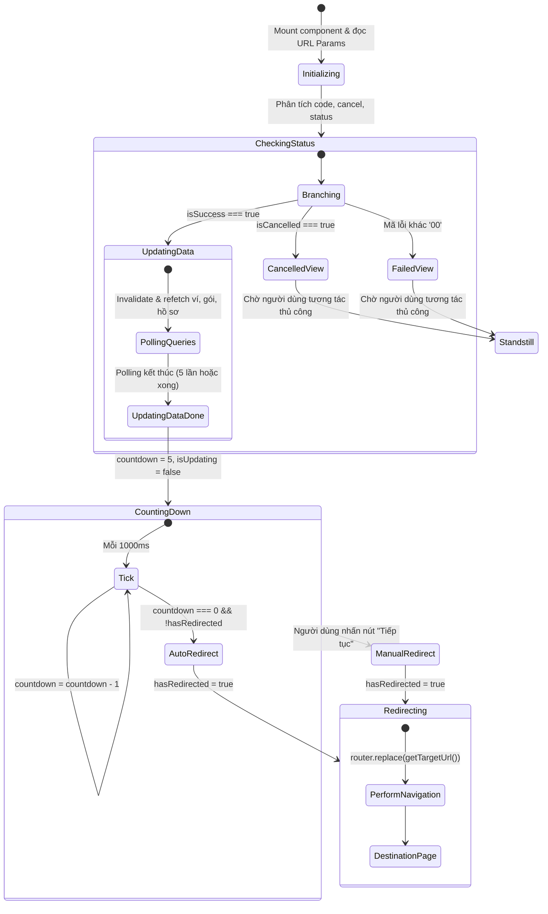

# Data Model: 035 Payment Success Countdown Redirect

## Overview

Tính năng này hoạt động thuần túy ở tầng Client UI Component của Next.js (`PaymentResultClient.tsx`), quản lý trạng thái hiển thị kết quả giao dịch và tiến trình đếm ngược điều hướng tự động.

---

## State Model: `PaymentResultState`

Mô hình trạng thái tại client component quản lý toàn bộ vòng đời của trang kết quả thanh toán.

```typescript
export interface PaymentResultState {
  /**
   * Mã kết quả từ cổng thanh toán (ví dụ: '00' là thành công)
   */
  code: string | null;

  /**
   * Cờ hủy thanh toán (ví dụ: 'true' nếu người dùng hủy)
   */
  cancel: string | null;

  /**
   * Trạng thái chuỗi từ cổng thanh toán (ví dụ: 'CANCELLED', 'PAID')
   */
  status: string | null;

  /**
   * Mã đơn hàng định danh giao dịch
   */
  orderCode: string | null;

  /**
   * Luồng thanh toán: 'topup' (nạp ví) hoặc 'purchase' (mua gói)
   */
  flow: 'topup' | 'purchase' | string | null;

  /**
   * Đường dẫn chuyển tiếp tùy chỉnh nếu có
   */
  next: string | null;

  /**
   * Cờ xác định giao dịch thành công hợp lệ
   * isSuccess = code === '00' && cancel !== 'true'
   */
  isSuccess: boolean;

  /**
   * Cờ xác định giao dịch bị hủy
   * isCancelled = cancel === 'true' || status === 'CANCELLED'
   */
  isCancelled: boolean;

  /**
   * Đang trong tiến trình polling đồng bộ dữ liệu tài khoản
   */
  isUpdating: boolean;

  /**
   * Số giây đếm ngược còn lại trước khi tự động chuyển trang
   * Giá trị ban đầu: 5 (khi bắt đầu đếm ngược), giảm dần về 0
   */
  countdown: number;

  /**
   * Cờ bảo vệ ngăn chặn việc điều hướng lặp lại / race condition
   */
  hasRedirected: boolean;
}
```

---

## State Transition Flow (Vòng đời trạng thái)



---

## Validation & Business Rules

1. **Điều kiện kích hoạt đếm ngược (`Countdown Guard`)**:
   - Chỉ kích hoạt khi: `isSuccess === true` VÀ `isUpdating === false`.
   - Nếu `isSuccess === false` (hủy hoặc thất bại): Không bao giờ kích hoạt timer, `countdown` không hoạt động.
2. **Quy tắc giải quyết trang đích (`Target Destination Rule`)**:
   - Nếu `next` tồn tại và hợp lệ (`next.startsWith('/') && !next.startsWith('//')`): `targetUrl = next`.
   - Nếu không có `next` hợp lệ:
     - Nếu `flow === 'purchase'`: `targetUrl = '/pricing'`.
     - Nếu ngược lại (`flow === 'topup'` hoặc mặc định): `targetUrl = '/profile?tab=wallet'`.
   - Cả hai luồng chuyển trang (tự động khi `countdown === 0` và thủ công khi click nút) **BẮT BUỘC** gọi chung một hàm giải quyết `getTargetUrl()`.
3. **Cơ chế chống chuyển trang kép (`Idempotency Guard`)**:
   - Khi lệnh chuyển hướng đầu tiên được phát đi (do người dùng click hoặc do timer kết thúc), cờ `hasRedirectedRef.current = true` được bật ngay lập tức.
   - Bất kỳ lời gọi chuyển trang nào tiếp theo đều bị bỏ qua (noop).
4. **Dọn dẹp tài nguyên (`Cleanup Rule`)**:
   - Khi component unmount hoặc khi chuyển trang thành công, toàn bộ `intervalId` của bộ đếm ngược phải được `clearInterval` sạch sẽ.
