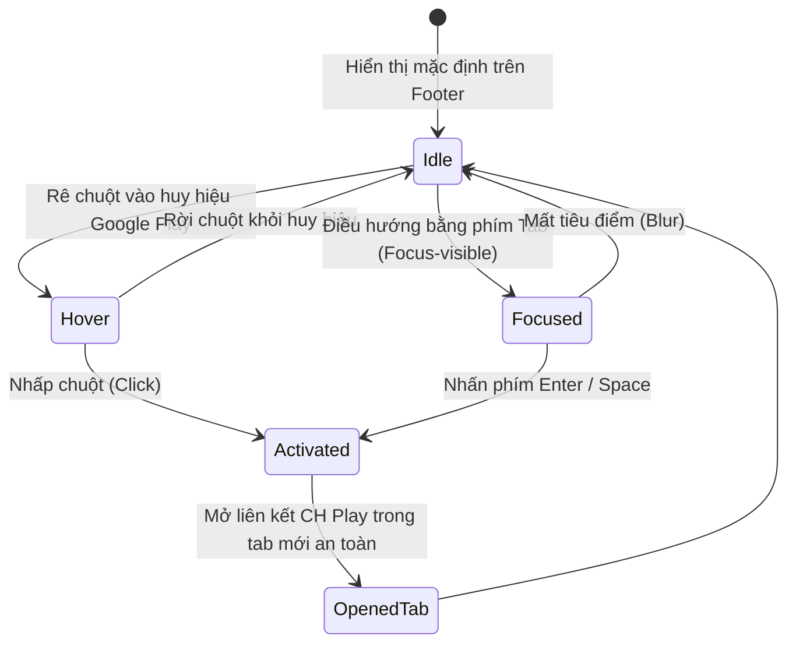

# Data Model: 036 Tích hợp Huy hiệu Google Play và Tái cấu trúc Footer

**Branch**: `036-footer-google-play` | **Date**: 2026-10-20 | **Spec**: [spec.md](./spec.md)

---

## 1. Entities & Data Structures

Do tính năng thuộc phạm vi giao diện người dùng (Frontend UI Component), các thực thể chủ yếu là mô hình dữ liệu cấu hình giao diện (UI Configuration Models) và props của React Component.

### 1.1 `StoreDownloadChannel` (Kênh Tải Ứng Dụng Di Động)

Đại diện cho thông tin một kênh phát hành ứng dụng di động chính thức của Closy.

| Thuộc tính | Kiểu dữ liệu | Bắt buộc | Mô tả |
|---|---|---|---|
| `id` | `string` | Có | Định danh kênh (ví dụ: `'google-play'`, `'app-store'`) |
| `platform` | `'android' \| 'ios'` | Có | Nền tảng hệ điều hành di động |
| `name` | `string` | Có | Tên cửa hàng ứng dụng (`'Google Play'`) |
| `url` | `string` | Có | Đường dẫn tải ứng dụng chính thức (`https://play.google.com/store/apps/details?id=online.hycat.closy&pcampaignid=web_share`) |
| `status` | `'active' \| 'coming_soon'` | Có | Trạng thái phát hành (`'active'` cho Google Play) |
| `badgeSubText` | `string` | Có | Dòng chữ phụ (`'TẢI TRÊN'` hoặc `'GET IT ON'`) |
| `badgeMainText`| `string` | Có | Dòng chữ chính (`'Google Play'`) |
| `ariaLabel` | `string` | Có | Nhãn trợ năng mô tả cho trình đọc màn hình |

### 1.2 `FooterNavigationItem` (Mục Liên Kết Chân Trang)

Đại diện cho một liên kết điều hướng hoặc trang chính sách pháp lý trong footer.

| Thuộc tính | Kiểu dữ liệu | Bắt buộc | Mô tả |
|---|---|---|---|
| `id` | `string` | Có | Mã định danh duy nhất của liên kết |
| `label` | `string` | Có | Văn bản hiển thị của liên kết |
| `href` | `string` | Có | Đường dẫn đích (`/privacy`, `/delete-account`, `mailto:...`) |
| `isExternal` | `boolean` | Không | `true` nếu là liên kết ngoài hoặc giao thức email |
| `ariaLabel` | `string` | Có | Nhãn trợ năng cho liên kết |

### 1.3 `FooterBrandConfig` (Cấu Hình Thương Hiệu Chân Trang)

Đại diện cho thông tin nhận diện thương hiệu hiển thị ở cột chính của footer.

| Thuộc tính | Kiểu dữ liệu | Bắt buộc | Mô tả |
|---|---|---|---|
| `brandName` | `string` | Có | Tên thương hiệu hiển thị: `'CLOSY'` |
| `tagline` | `string` | Có | Khẩu hiệu định vị: `'Tủ Đồ Thông Minh Số'` |
| `description` | `string` | Có | Mô tả ngắn: `'Trợ lý quản lý tủ đồ & gợi ý phong cách thời trang cá nhân hóa bằng AI.'` |
| `copyrightText`| `string` | Có | Dòng bản quyền: `'© 2026 Closy. Built by HYCAT TEAM.'` |
| `contactEmail` | `string` | Có | Email hỗ trợ: `'hycat.support@gmail.com'` |

---

## 2. Component Interface Props

### 2.1 `GooglePlayBadgeProps`

Props của component nút bấm tải Google Play:

```typescript
export interface GooglePlayBadgeProps {
  /**
   * Tùy chọn ghi đè URL đích (mặc định lấy URL chính thức của Closy)
   */
  href?: string;

  /**
   * Các class CSS Tailwind bổ sung cho container nút
   */
  className?: string;

  /**
   * Ngôn ngữ hiển thị nhãn: 'vi' (TẢI TRÊN) | 'en' (GET IT ON)
   * Mặc định: 'vi'
   */
  locale?: 'vi' | 'en';

  /**
   * Kích thước nút: 'sm' | 'md' | 'lg'
   * Mặc định: 'md'
   */
  size?: 'sm' | 'md' | 'lg';

  /**
   * Callback khi người dùng nhấp vào nút (cho analytics/tracking)
   */
  onClick?: () => void;
}
```

---

## 3. Trạng Thái Vòng Đời & Tương Tác



### Quy tắc xác thực:
1. URL đích của Google Play bắt buộc phải là một liên kết hợp lệ, bắt đầu bằng `https://play.google.com/store/apps/details?id=online.hycat.closy`.
2. Khi mở liên kết ngoài, các thuộc tính `target="_blank"` và `rel="noopener noreferrer"` là bắt buộc.
3. Nhãn trợ năng `aria-label` không được để trống.
