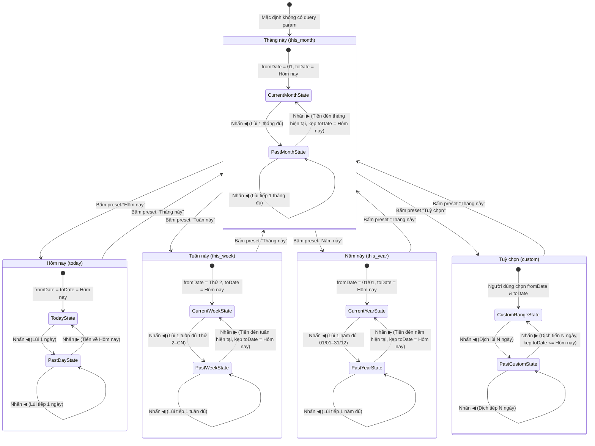

# Data Model & State Transitions: Bộ Chọn Kỳ Dùng Chung (037-admin-period-navigator)

**Feature**: `037-admin-period-navigator` | **Date**: 2026-10-20 | **Status**: Approved

## 1. Mô Hình Thực Thể & Định Nghĩa Kiểu (Types & Interfaces)

```ts
/**
 * 5 định danh preset chu kỳ chuẩn hóa.
 */
export type PeriodPreset =
  | 'today'      // Hôm nay
  | 'this_week'   // Tuần này (Thứ 2 -> hôm nay)
  | 'this_month'  // Tháng này (01 -> hôm nay)
  | 'this_year'   // Năm này (01/01 -> hôm nay)
  | 'custom';     // Tuỳ chọn khoảng ngày

/**
 * Cấu trúc trạng thái khoảng thời gian đồng bộ với URL query parameters.
 */
export interface PeriodRange {
  preset: PeriodPreset;
  fromDate: string; // Định dạng YYYY-MM-DD (Giờ Việt Nam)
  toDate: string;   // Định dạng YYYY-MM-DD (Giờ Việt Nam)
}

/**
 * Hướng điều hướng lùi hoặc tiến.
 */
export type NavigationDirection = 'prev' | 'next';

/**
 * Kết quả tính toán sau khi di chuyển tiến/lùi kỳ.
 */
export interface NavigationResult {
  preset: PeriodPreset;
  fromDate: string;
  toDate: string;
  isAtCurrent: boolean; // True nếu toDate đã chạm mốc hôm nay (vô hiệu hóa nút ▶)
}

/**
 * Thông tin nhãn hiển thị định dạng chuẩn.
 */
export interface PeriodLabelInfo {
  unitTitle: string;    // Ví dụ: "Tháng 10/2026", "Tuần 42/2026", "Năm 2026", "Hôm nay", "Tuỳ chọn"
  dateRangeText: string; // Ví dụ: "01/10 – 20/10/2026", "20/10/2026"
  formattedText: string; // Nhãn hoàn chỉnh: "Tháng 10/2026 · 01/10 – 20/10/2026"
}
```

---

## 2. Quy Tắc Ràng Buộc & Tính Hợp Lệ (Validation Rules)

1. **Định dạng ngày**: Mọi chuỗi ngày phải tuân thủ nghiêm ngặt chuẩn `YYYY-MM-DD`.
2. **Thứ tự ngày**: Luôn đảm bảo `fromDate <= toDate`.
3. **Giới hạn tương lai (Future date clamping)**:
   - `toDate <= todayVN()` cho mọi trạng thái.
   - Bất kỳ phép toán tiến chu kỳ ▶ nào dẫn đến `toDate > todayVN()` đều tự động được kẹp về `todayVN()`.
4. **Kỳ quá khứ đầy đủ (Full past units)**:
   - Tuần quá khứ: Bắt đầu lúc Thứ Hai và kết thúc lúc Chủ Nhật ($7$ ngày).
   - Tháng quá khứ: Bắt đầu lúc ngày 01 và kết thúc lúc ngày cuối cùng của tháng đó.
   - Năm quá khứ: Bắt đầu lúc 01/01 và kết thúc lúc 31/12.
5. **Kỳ tùy chọn**:
   - Khoảng cách ngày $D = \text{daysDifference}(fromDate, toDate) + 1$.
   - Khi lùi ◀: Dịch chuyển lùi đúng $D$ ngày: `[fromDate - D, toDate - D]`.
   - Khi tiến ▶: Dịch chuyển tiến đúng $D$ ngày: `[fromDate + D, toDate + D]`. Nếu `toDate + D > todayVN()`, kẹp `toDate = todayVN()`.

---

## 3. Sơ Đồ Chuyển Trạng Thái (State Transitions)


