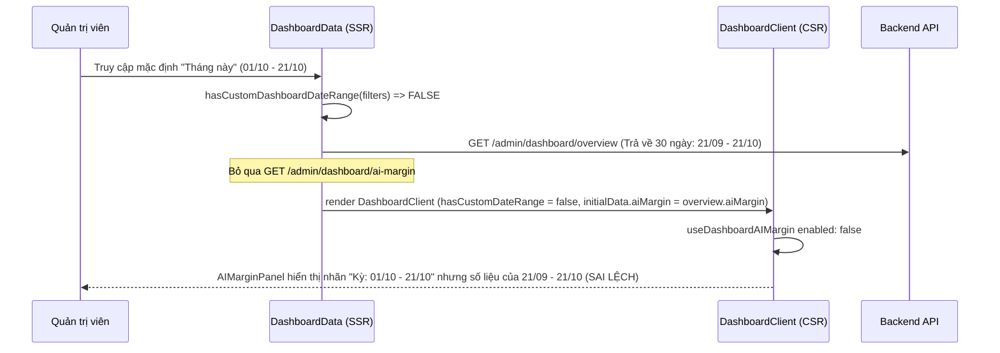
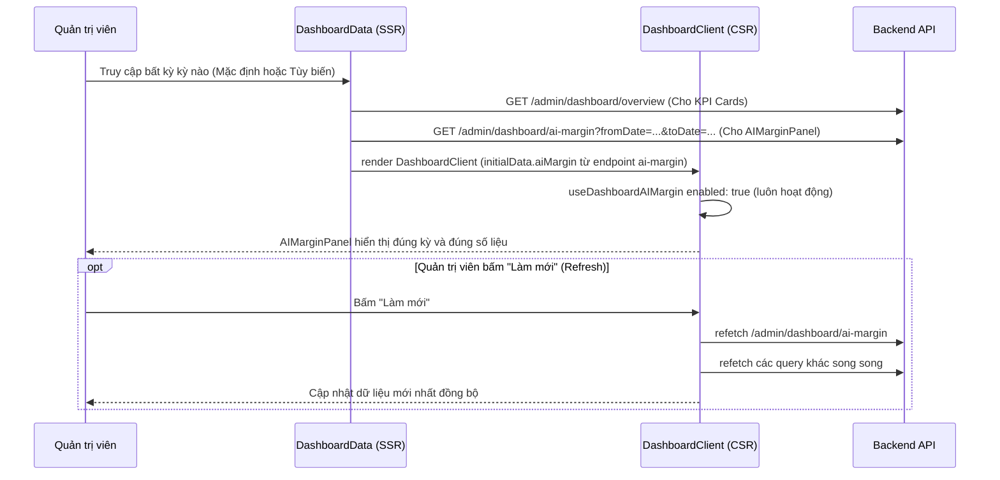

# Data Model & State Transitions: Đồng Bộ Kỳ Báo Cáo Cho Bảng Hiệu Quả Chi Phí AI (038-fix-dashboard-ai-margin)

**Date**: 2026-10-21  
**Feature**: [spec.md](./spec.md) | **Plan**: [plan.md](./plan.md)

---

## 1. Data Models (TypeScript Interfaces)

Tính năng này sử dụng lại các interface hiện có trong `src/features/admin/types`, đồng thời chuẩn hóa luồng truyền dữ liệu giữa SSR và CSR.

### 1.1 `AIMarginAnalytics`
Kiểu dữ liệu trả về từ endpoint `/admin/dashboard/ai-margin?fromDate=...&toDate=...`:

```typescript
export interface AIMarginAnalytics {
  fromDate: string;              // YYYY-MM-DD
  toDate: string;                // YYYY-MM-DD
  subscriptionRevenueVnd: number; // Tổng doanh thu đăng ký trong kỳ (VND)
  aiCostVnd: number;             // Tổng chi phí token AI trong kỳ (VND)
  netMarginVnd: number;          // Lợi nhuận ròng = subscriptionRevenueVnd - aiCostVnd
  marginPercent: number;         // Tỷ suất biên lợi nhuận %
  tokenBreakdown: {              // Phân rã token và chi phí theo tác vụ
    virtualTryOn: TokenUsageDetail;
    outfitSuggestion: TokenUsageDetail;
    itemAnalysis: TokenUsageDetail;
    styleQuiz: TokenUsageDetail;
  };
}
```

### 1.2 `DashboardInitialData`
Cấu trúc dữ liệu nạp ban đầu từ Server Component (`DashboardData.tsx`) xuống Client Component:

```typescript
export interface DashboardInitialData {
  overview: AdminOverview | null | undefined;
  aiMargin: AIMarginAnalytics | null | undefined; // [CHUẨN HÓA] Luôn nạp từ endpoint ai-margin chuyên biệt
  analytics: DynamicQueryResponse | null | undefined;
  aiEvents: AIEventList | null | undefined;
  payosReconciliation: PayOSReconciliation | null | undefined;
  subscriptionDistribution?: SubscriptionDistribution | null;
  revenueBreakdown?: RevenueBreakdown | null;
  renewalStats?: RenewalStats | null;
  aiUsageByOperation?: AIUsageByOperation | null;
  aiErrorBreakdown?: AIErrorBreakdown | null;
}
```

### 1.3 `DashboardClientProps`
Props truyền vào `DashboardClient`:

```typescript
export interface DashboardClientProps {
  filters: DashboardFilters;
  initialData: DashboardInitialData;
  // [ĐÃ LOẠI BỎ]: hasCustomDateRange?: boolean;
}
```

---

## 2. State & Data Flow Transitions

### 2.1 Trước khi sửa (Old Flow - Broken)



### 2.2 Sau khi sửa (New Flow - Correct & Unified)


